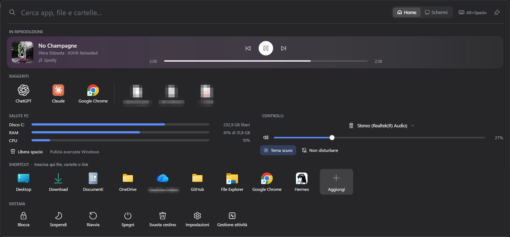
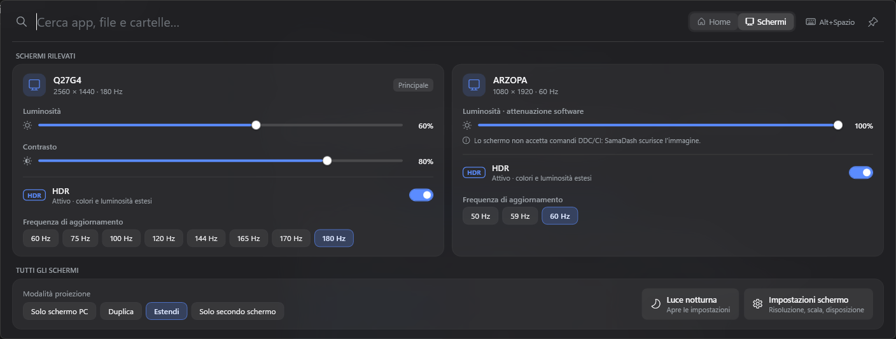
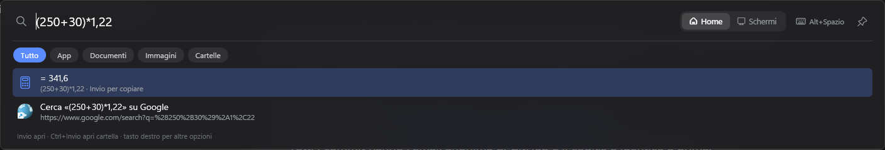
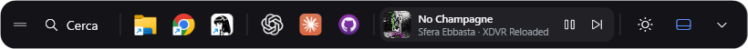

# SamaDash

Dashboard a scomparsa in alto sullo schermo per Windows 11. Si apre con una scorciatoia (Alt+Spazio), dall'icona nella tray o dalla mini barra.



<details>
<summary>Altre schermate</summary>

**Schermi**: luminosità, contrasto, HDR e frequenza per ogni monitor collegato



**Calcoli nella ricerca**



**Mini barra** sempre visibile, con app fissate, suggerite, musica e accesso agli schermi



</details>

- **Ricerca istantanea** di app e file su tutto il PC (motore [Everything](https://www.voidtools.com/)), con i filtri Tutto / App / Documenti / Immagini / Cartelle
- **Suggeriti**: le app che usi di più a quest'ora e in questo giorno, più gli ultimi file aperti
- **Shortcut** personalizzati: trascina sulla barra file, cartelle o link, oppure usa "+"
- **Azioni di sistema**: Blocca, Sospendi, Riavvia, Spegni, Svuota cestino, Impostazioni, Gestione attività
- **Calcoli nella ricerca**: `15*3`, `10 km in mi`, `20 eur in usd` (tassi BCE); in fondo ai risultati "Cerca su Google"
- **Salute PC**: barre per disco, RAM e CPU; "Libera spazio" per Temp, Cestino e cache dei browser, con anteprima dei GB recuperabili
- **Controlli rapidi**: uscita audio, volume e muto, tema chiaro/scuro, Non disturbare
- **Schermi** (scheda dedicata): per ogni monitor collegato luminosità e contrasto via DDC/CI, luminosità WMI sui portatili, oppure oscuramento software se lo schermo non accetta comandi; HDR on/off, frequenza di aggiornamento, modalità di proiezione (come Win+P), Luce notturna. Tutto rilevato in automatico
- **In riproduzione**: brano, copertina e controlli di qualsiasi app che usa i controlli multimediali di Windows (Spotify, browser, lettori), con scelta della fonte se ce n'è più d'una
- **Mini barra** sempre visibile, spostabile ovunque, con le app fissate sulla taskbar (sincronizzate), le suggerite, il brano in riproduzione e l'accesso rapido agli schermi

## Test
```powershell
dotnet test SamaDash.Tests
```

## Requisiti
- Windows 11 (Windows 10 2004+ per la maggior parte delle funzioni), .NET 10 SDK
- Everything: `winget install voidtools.Everything` e `winget install voidtools.Everything.Cli`

## Installazione
```powershell
powershell -ExecutionPolicy Bypass -File install.ps1
```
Compila il progetto, lo installa in `%LOCALAPPDATA%\Programs\SamaDash`, crea il collegamento nel menu Start e lo avvia. Al primo avvio attiva anche l'avvio con Windows (lo puoi disattivare dal menu della tray).

## Uso
| Azione | Come |
|---|---|
| Aprire/chiudere | Alt+Spazio (modificabile), clic sull'icona nella tray o SamaDash dal menu Start |
| Aprire il risultato | Invio o clic |
| Aprire la cartella del file | Ctrl+Invio |
| Altre opzioni | tasto destro su un elemento |
| Tenerla aperta (es. per trascinare file) | puntina in alto a destra |
| Chiudere | Esc o clic fuori dalla barra |

## Dati
I dati restano solo su questo PC, in `%LOCALAPPDATA%\SamaDash`:
- `shortcuts.json`: gli shortcut, modificabili anche a mano
- `settings.json`: impostazioni (scorciatoia, posizione della mini barra, oscuramento software per schermo)
- `usage.json`: le abitudini d'uso, cioè i secondi in primo piano per app, divisi per giorno e ora
- `errors.log`: gli eventuali errori

## Note
- L'interfaccia è in italiano.
- DDC/CI va attivato nel menu del monitor su alcuni modelli; se non risponde, SamaDash usa l'oscuramento software.
- Il design dell'interfaccia è su Figma (file "SamaDash – Schermi").

## Licenza
[MIT](LICENSE)
